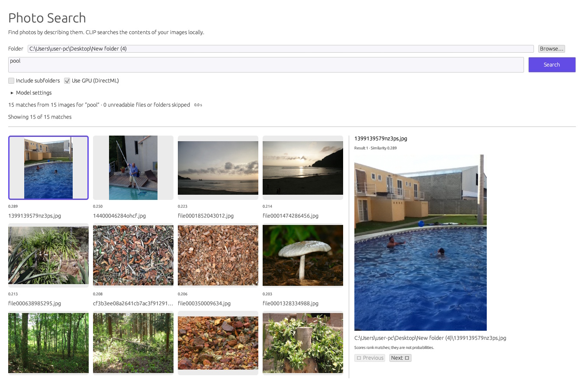

# Image Tag Search

Native Rust photo search using `ort` (ONNX Runtime) and egui/eframe. Pick a folder, enter a description such as **a swimming pool**, and browse ranked images in a grid. The first 50 matches appear initially; click **Fetch next 50** to reveal more without rerunning the search. Click a thumbnail for a larger preview.



```powershell
./setup-clip.ps1
cargo run --locked --bin clip-search
```

CLIP is the default executable, so `cargo run --locked` also opens search. Run `./setup-clip.ps1` from the repository root to download the paired Xenova CLIP ViT-B/32 ONNX encoders (about 606 MB) and tokenizer files directly into this project's `Model/CLIP/` folder. Setup requires an internet connection and skips files that already exist. After setup, searches run locally; no other project is required.

If you already have the four required CLIP files, you can copy them from a local folder instead:

```powershell
./setup-clip.ps1 -SourceDirectory "C:/path/to/CLIP"
```

Windows x64, stable Rust MSVC, Visual Studio C++ build tools and the Windows SDK are required. Native ONNX Runtime and DirectML DLLs are bundled under `Runtime/` and copied alongside the executable by `build.rs`.

- Folder picker, text query, recursive search enabled by default.
- Ranked thumbnail grid, cosine scores, larger selected-photo preview, previous/next navigation.
- Background model inference and thumbnail decoding; progress, elapsed time, cancellation between images.
- GPU through DirectML, adapter selection and automatic CPU fallback. Model settings show the actual device for each encoder.
- In-memory image embeddings cached by path, file size and modification time, plus cached text embeddings. Changing models or device clears the embeddings. Closing the app clears the cache.
- JPEG, PNG, WebP, BMP and GIF (first frame); unreadable images are skipped and counted. Scores express relative ranking, not confidence percentages.

The port follows the reference's byte-level CLIP BPE tokenizer (77-token limit), RGB normalization, bicubic shortest-edge resize to 224 and center crop. Resampler differences from ImageSharp can produce slightly different scores. All searches run locally after model setup.

Build a portable release with `./package-clip.ps1`; extract `dist/ClipSearch-win-x64.zip` and run `clip-search.exe`. Keep the model folder and runtime DLLs with the executable. Model details and attribution are in [Model/CLIP/README.md](Model/CLIP/README.md).

Validation:

```powershell
cargo test --locked
cargo clippy --locked --all-targets -- -D warnings
cargo run --locked --bin clip-search -- --smoke-test --folder "C:/path/to/photos"
```

The smoke test runs real CPU inference for two queries, verifies finite sorted cosine scores, and exercises cached repeat search. On the 34 reference listing photos it ranked `104966269_5.jpg` first for “a swimming pool”; the second query reused image embeddings.
